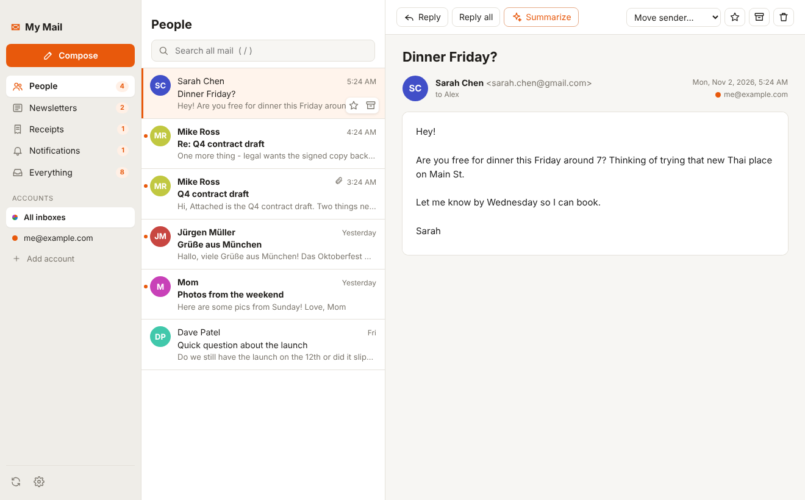

# My Mail

A personal, local-first desktop email app in the spirit of Hey / Spark.
All your accounts in one window, sorted automatically, with Claude summaries on demand.

```
┌──────────────┬───────────────────────┬─────────────────────────────────┐
│ ✉ My Mail    │ People                │ Reply  Reply all  ✨ Summarize   │
│ [Compose]    │ 🔍 Search all mail     │                                 │
│ People     4 │ ● Sarah  Dinner Fri?  │ Dinner Friday?                  │
│ Newsletters 2│ ● Mike   Q4 contract  │ ┌ ✨ Summary ────────────────┐  │
│ Receipts   1 │   Mom    Photos       │ │ • Dinner Fri 7pm, Thai     │  │
│ Notifs     1 │   Dave   Launch?      │ │ Action: reply by Wed       │  │
│ Everything   │                       │ └────────────────────────────┘  │
│ ── Accounts  │                       │                                 │
│ ● Gmail      │                       │                                 │
│ ● Hotmail    │                       │                                 │
└──────────────┴───────────────────────┴─────────────────────────────────┘
```



## Features

| | |
|---|---|
| **Unified inbox** | Gmail, Outlook/Hotmail/Live, Yahoo, iCloud, AOL, Fastmail, any IMAP server |
| **Smart inbox** | Auto-sorts into People / Newsletters / Receipts / Notifications. "Move sender…" retrains it per sender or per domain |
| **AI (Claude)** | ✨ Summarize a thread (with the action you need to take) and ✨ Draft reply from a one-line instruction |
| **Privacy** | Mail is cached on your computer only. Remote images (tracking pixels) are blocked until you click "Load images". Logins are encrypted with your OS keychain |
| **Fast** | Local SQLite cache with full-text search (`/`) |
| **Keyboard** | `j`/`k` move · `e` archive · `#` delete · `r` reply · `s` summarize · `c` compose · `⌘/Ctrl+Enter` send |

## Install on your Mac

Requires [Node.js 22+](https://nodejs.org). In Terminal, from this folder:

```bash
npm install
npm run mac
```

This builds **My Mail.app**, copies it to **/Applications** and opens it. After that, open it from
Launchpad or Spotlight like any other app (right-click its Dock icon → Options → Keep in Dock).
To update later: `git pull && npm run mac`.

No Apple Developer account is needed: the app is "ad-hoc" signed on your own Mac, so macOS opens it without warnings.
Want an installer to share? `npm run dist` makes a `.dmg` in `dist/`. Other Macs will show an
"unidentified developer" warning (right-click → Open the first time) unless it's signed with a paid Apple Developer ID.

### For development

```bash
npm run dev        # run from source with hot reload
npm test           # unit tests
```

## Connecting accounts

### Quickest: app passwords (Gmail, Yahoo, iCloud, …)
**Add account → Other (IMAP).** Enter your email and an **app password**; server settings fill in automatically for common providers.

- Gmail: turn on 2-Step Verification, then create one at <https://myaccount.google.com/apppasswords>
- Yahoo: Account security → Generate app password
- iCloud: <https://account.apple.com> → Sign-In and Security → App-Specific Passwords

> For Gmail used only by you, an app password is the **recommended** route: it never expires and needs no Google Cloud setup.

### Gmail with "Sign in with Google" (optional)
1. Open <https://console.cloud.google.com/> and create a project.
2. **APIs & Services → Enable APIs** → enable **Gmail API**.
3. **OAuth consent screen**: User type **External**, add your own email as a **test user**.
4. **Credentials → Create credentials → OAuth client ID → Desktop app**.
5. Paste the **Client ID** and **Client secret** into My Mail → Settings.

> ⚠️ While the consent screen is in **Testing**, Google expires the login every **7 days** and you'll need to re-add the account. To avoid that, click **Publish app** on the consent screen. You'll then see an "unverified app" warning when you sign in, which is fine for personal use (up to 100 users). Verification (a paid security audit) is only needed if you distribute the app publicly.

### Outlook / Hotmail / Live (Microsoft no longer allows passwords; sign-in required)
1. Open <https://portal.azure.com> → **App registrations → New registration**.
2. Supported account types: **Accounts in any organizational directory and personal Microsoft accounts**.
3. Redirect URI: platform **Public client/native (mobile & desktop)**, URI `http://localhost`.
4. After creating it: **Authentication → Allow public client flows → Yes** → Save.
5. **API permissions → Add → APIs my organization uses → Office 365 Exchange Online → Delegated**: tick `IMAP.AccessAsUser.All` and `SMTP.Send`.
6. Copy the **Application (client) ID** into My Mail → Settings.

### AI summaries
Create a key at <https://console.anthropic.com/> and paste it in Settings. The thread is sent to Anthropic only when you click **Summarize** or **Draft reply**. You can switch between Opus (best), Sonnet, or Haiku (cheapest) in Settings.

## How it works

```
Gmail / Outlook / IMAP ──IMAP (imapflow)──▶ Sync engine ──▶ SQLite + full-text index ──▶ React UI
                       ◀──SMTP (nodemailer)── Compose
                                              Claude API ◀── Summarize / Draft reply
```

| Folder | What's in it |
|---|---|
| `src/main/` | Electron main process: OAuth (`oauth.ts`), accounts and token refresh (`accounts.ts`), IMAP sync (`sync.ts`), SMTP (`send.ts`), smart sorting (`categorize.ts`), Claude (`ai.ts`), database (`db.ts`) |
| `src/preload/` | The secure bridge exposing `window.api` to the UI |
| `src/renderer/` | React UI |
| `tests/` | Unit tests (sorting, MIME decoding, database/search) |

Security notes: the UI runs sandboxed with no Node access. Email HTML is sanitized with DOMPurify and rendered in a sandboxed iframe where scripts can't run. Links open in your normal browser.

## Status & roadmap

- [x] Phase 1–2: accounts, sync, unified inbox, read/reply/send, archive/delete/star
- [x] Phase 3: smart inbox with per-sender/domain training
- [x] Phase 4: Claude summaries and reply drafts
- [ ] Push (IMAP IDLE) instead of polling every 2 minutes
- [ ] Conversation view (stacked thread), attachments download, rich-text compose
- [ ] Snooze, reminders, "Screener" for first-time senders
- [ ] Optional AI sorting for messages the rules aren't sure about
